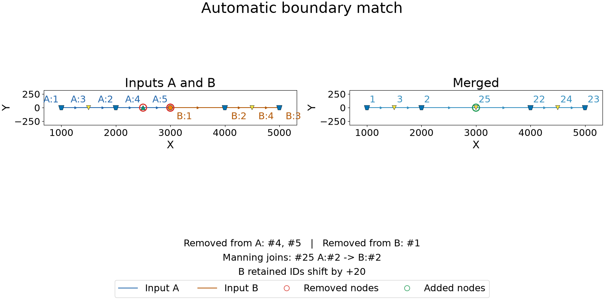
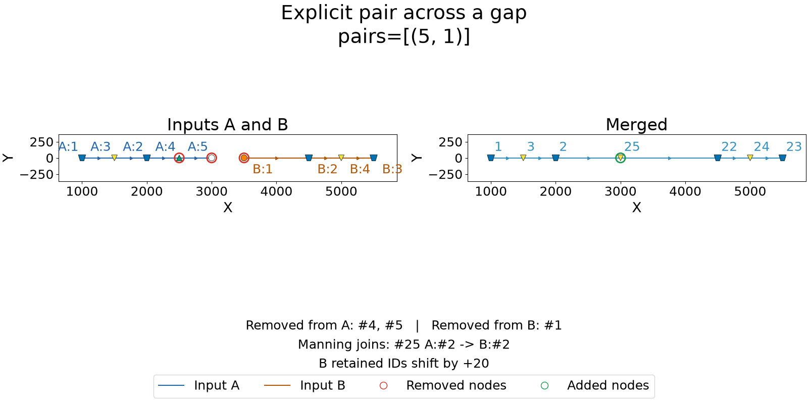
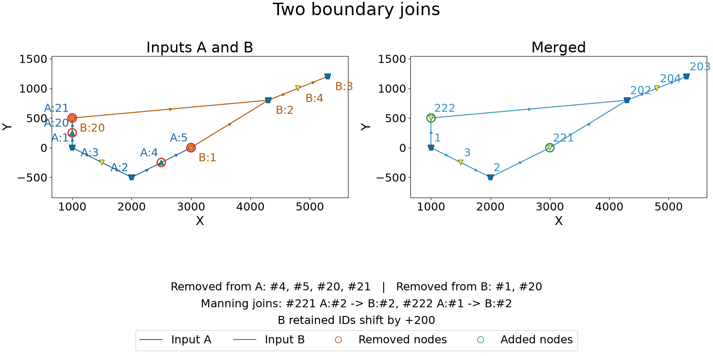

Large models are often built per region, for example one model per water board, and later have to be combined.
`ribasim.merge.merge_models` concatenates two models into one, and connects them where they overlap.

# How it works

Two models overlap where they both have a boundary node (`Terminal`, `LevelBoundary` or `FlowBoundary`) on the same location, one just upstream and the other just downstream of the border.
`merge_models` removes each such pair of boundary nodes, together with a connector node (such as a `LinearResistance`) between a boundary node and its `Basin`, and puts a new `ManningResistance` between the two `Basin`s.
The new node is placed at the boundary location from the first model; a warning is logged when the paired boundary locations are farther apart than `tolerance`.

The merged model:

- Keeps the configuration of the first model, including `starttime` and `endtime`. A warning is logged if the two models differ in these.
- Has the nodes and links of the second model with ids shifted by the highest id of the first model, or by an `id_prefix`, such as `2` to turn id `15` into `215`.
- Has `subnetwork_id`s of the second model renumbered to continue after those of the first model.
- Marks the new `ManningResistance` nodes with `meta_merged = True`.
- Leaves both input models unchanged.

Listeners such as a `PidControl` or `DiscreteControl` of a removed `LevelBoundary` on its `level` are repointed to the `Basin` that replaces it.
The merge fails with a clear error if a removed node is listened to or controlled in a way that cannot be preserved, if the models have a different CRS, or if the result has a `Basin` with a profile that rises in the downstream direction.

# Example

```python
from ribasim import Model
from ribasim.merge import ManningParameters, merge_models

upstream = Model.read("upstream/ribasim.toml")
downstream = Model.read("downstream/ribasim.toml")

# Parameters of the new ManningResistance nodes
manning = ManningParameters(
    length=100.0,  # m
    manning_n=0.03,  # s m^-1/3
    profile_width=10.0,  # m
    profile_slope=2.0,  # -
)

merged = merge_models(upstream, downstream, manning=manning)
merged.write("merged/ribasim.toml")
```

By default boundary nodes are paired by location, within `tolerance` meters (`1e-6` by default).
If both models have `meta_authority` and `meta_couple_authority` columns on their nodes, the `meta_couple_authority` of each node must also equal the `meta_authority` of the other, so that nearby nodes of unrelated authorities are not joined.
To choose the nodes to join yourself, pass `pairs` with the `(node_id_in_first_model, node_id_in_second_model)` of each pair, using the original node ids:

```python
merged = merge_models(upstream, downstream, manning=manning, pairs=[(5, 12)])
```

# Visual examples

Each figure overlays the two input models in the left panel and shows the merged network separately in the right panel, plotted with `Model.plot()`.
Blue links and labels belong to Input A; orange links and labels belong to Input B, with labels `A:<id>` and `B:<id>` to distinguish coincident nodes.
Red circles highlight removed nodes in the inputs; green circles highlight newly added `ManningResistance` nodes in the merged network.
Input A retains its node ids; the examples use `id_prefix=2` when merging to distinguish the retained nodes from Input B.
New `ManningResistance` nodes are listed below each figure, together with the removed boundary and connector nodes.

## Automatic boundary matching

The downstream `LevelBoundary` of Input A coincides with the upstream `FlowBoundary` of Input B.
The merge removes A's nodes 4 and 5 and B's node 1, replacing them with a `ManningResistance` connecting the adjacent Basins.

{#fig-merge-automatic}

## Explicit pairing across a gap

Explicit `pairs` can connect boundary nodes that do not overlap.
The replacement node uses Input A's boundary location, and the merge logs a warning if the distance exceeds `tolerance`.

{#fig-merge-explicit}

## Two boundary joins

Both branches connect to Basin 2 in Input B (node 202 in the merged model):

- A's nodes 20 and 21 and B's node 20 are replaced by a `ManningResistance` between A's Basin 1 and B's Basin 2.
- A's nodes 4 and 5 and B's node 1 are replaced by a `ManningResistance` between A's Basin 2 and B's Basin 2.

The new nodes stay at Input A's boundary locations, preserving the branch layout.

{#fig-merge-two-joins}
